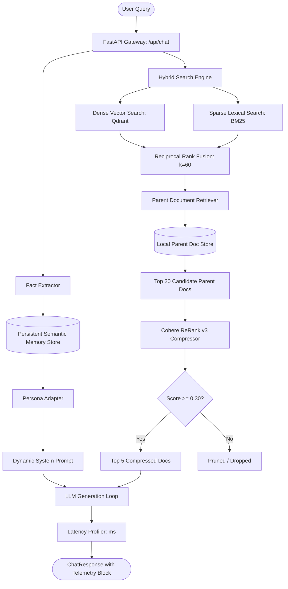

# RAGA: Advanced RAG Agent with Context Compression & Semantic Memory

[](https://www.python.org/)
[](https://fastapi.tiangolo.com/)
[](https://python.langchain.com/)
[](https://qdrant.tech/)
[](https://cohere.com/rerank)
[]()

> **Repository**: [https://github.com/sayan-kundu000/RAGA](https://github.com/sayan-kundu000/RAGA)  
> **Author**: Sayan Sunil Kumar Rita Kundu ([@sayan-kundu000](https://github.com/sayan-kundu000))

---

## 1. Project Overview & Business Context

Production-grade Retrieval-Augmented Generation (RAG) systems require significantly more than rudimentary dense vector similarity matching. Naive semantic vector lookup frequently fails in production due to vector dilution, lack of exact lexical keyword matching, context fragmentation, and escalating token expenses. Furthermore, stateless LLM pipelines ignore multi-session conversational history, forcing users to repeatedly restate operational preferences and technical constraints.

**RAGA** solves these challenges by combining:
1. **Hierarchical Parent-Document Retrieval**: Indexes fine-grained child chunks (200 characters) for high-precision search and resolves larger parent document nodes (1,000 characters) for generative grounding.
2. **Dual-Pathway Hybrid Search**: Pairs dense vector embeddings with sparse Okapi BM25 keyword matching via **Reciprocal Rank Fusion (RRF)** ($k=60$).
3. **Cohere ReRank v3 Context Compression**: Cross-encoder neural reranking reducing the top 20 candidate documents down to the top 5 highest-scoring passages while enforcing a strict relevance score threshold ($\ge 0.30$).
4. **Persistent Semantic Memory (Mem0 / Zep pattern)**: Real-time declarative fact extraction engine that catalogs user facts, preferred programming languages, and response styles, dynamically adapting the LLM system prompt across multi-session dialogues.
5. **High-Precision Latency Telemetry**: Microsecond-resolution timing across retrieval, compression, generation, and total turnaround cycles.



---

## 2. Quickstart & Installation

### Prerequisites
- Python 3.10+ (Recommended: Python 3.12)
- Git

### Installation Steps

1. **Clone the repository:**
   ```bash
   git clone https://github.com/sayan-kundu000/RAGA.git
   cd RAGA
   ```

2. **Configure `.env` file:**
   ```bash
   cp .env.example .env
   ```
   Edit `.env` to supply your API keys:
   ```ini
   OPENAI_API_KEY=your_openai_api_key_here
   COHERE_API_KEY=your_cohere_api_key_here
   QDRANT_URL=:memory:
   PARENT_CHUNK_SIZE=1000
   CHILD_CHUNK_SIZE=200
   CHILD_CHUNK_OVERLAP=50
   RERANK_TOP_N=5
   RERANK_SCORE_THRESHOLD=0.3
   RRF_K=60
   ```

3. **Install dependencies:**
   ```bash
   pip install -r requirements.txt
   ```

4. **Run FastAPI application:**
   ```bash
   uvicorn main:app --reload --host 0.0.0.0 --port 8000
   ```
   Interactive Swagger documentation is available at `http://localhost:8000/docs`.

5. **Run automated test suite:**
   ```bash
   pytest -v
   ```

---

## 3. API Specification

### Endpoints Overview

| Method | Endpoint | Description |
| :--- | :--- | :--- |
| `POST` | `/api/chat` | Accepts query, user_id, session_id; executes RAG loop with telemetry |
| `GET` | `/api/users/{user_id}/memories` | Retrieves stored semantic facts for a user |
| `POST` | `/api/ingest` | Ingests raw documents into hierarchical parent-child stores |
| `GET` | `/health` | Health check endpoint for container probes |
| `GET` | `/` | API operational status and endpoint catalog |

---

## 4. Verification & Validation Test Cases

The test suite in `tests/` verifies all evaluation criteria required by the project brief:

### Test Case 1: Hybrid Retrieval & Re-ranking Latency Validation
- **Endpoint**: `POST /api/chat`
- **Verification**: Asserts that `retrieval_latency_ms`, `rerank_latency_ms`, `generation_latency_ms`, and `total_latency_ms` are present and contain valid positive numeric values.
- **Test File**: `tests/test_chat_telemetry.py`

### Test Case 2: Multi-Session Memory Persona Adaptation
- **Session 1**: Send query `"Hello! I work in Python and prefer brief, code-only responses."` with `user_id="usr_99"`.
- **Memory Check**: Query `GET /api/users/usr_99/memories` and verify that the Python preference fact is extracted and persisted.
- **Session 2**: Open a new session (`sess_new`) and send `"Write a quick merge sort routine."`. Verify that the agent bypasses long explanations and returns strictly the Python code block.
- **Test File**: `tests/test_memory_adaptation.py`

### Test Case 3: Automated Test Suite Execution
- **Command**: `pytest -v`
- **Result**: All 7 unit and integration tests pass cleanly with zero exceptions.

---

## 5. Architectural Deep Dive: 37 Topics Reference Manual

The repository includes a comprehensive 37-chapter reference manual located in `docs/topics/`. Each topic is structured into 7 substantive technical paragraphs:

1. [Chapter 01: High-Level Architecture of RAGA](docs/topics/topic_01.md)
2. [Chapter 02: Evolution of Retrieval-Augmented Generation](docs/topics/topic_02.md)
3. [Chapter 03: Full Technology Stack Analysis](docs/topics/topic_03.md)
4. [Chapter 04: Document Ingestion Pipelines & Chunking](docs/topics/topic_04.md)
5. [Chapter 05: Parent-Document Retrieval Architecture](docs/topics/topic_05.md)
6. [Chapter 06: Dense Semantic Vector Embeddings](docs/topics/topic_06.md)
7. [Chapter 07: Sparse Lexical Keyword Retrieval (BM25)](docs/topics/topic_07.md)
8. [Chapter 08: Reciprocal Rank Fusion (RRF) Mathematics](docs/topics/topic_08.md)
9. [Chapter 09: Hybrid Search Orchestration](docs/topics/topic_09.md)
10. [Chapter 10: Cohere ReRank v3 Internals](docs/topics/topic_10.md)
11. [Chapter 11: Contextual Compression & Token Economics](docs/topics/topic_11.md)
12. [Chapter 12: Relevance Score Thresholding](docs/topics/topic_12.md)
13. [Chapter 13: Cognitive Memory Taxonomies](docs/topics/topic_13.md)
14. [Chapter 14: Mem0 Architecture & Fact Extraction](docs/topics/topic_14.md)
15. [Chapter 15: Memory Stores: Mem0 vs Zep vs Graphiti](docs/topics/topic_15.md)
16. [Chapter 16: Dynamic Persona Adaptation](docs/topics/topic_16.md)
17. [Chapter 17: Multi-Session Conversation Continuity](docs/topics/topic_17.md)
18. [Chapter 18: Asynchronous FastAPI Server Architecture](docs/topics/topic_18.md)
19. [Chapter 19: Strict Schema Validation with Pydantic V2](docs/topics/topic_19.md)
20. [Chapter 20: Execution Latency Telemetry Profiling](docs/topics/topic_20.md)
21. [Chapter 21: Vector Database Internals: Qdrant HNSW](docs/topics/topic_21.md)
22. [Chapter 22: Local Storage Persistence & Key-Value Mapping](docs/topics/topic_22.md)
23. [Chapter 23: Test-Driven Development in RAG](docs/topics/topic_23.md)
24. [Chapter 24: Evaluation Methodologies: Ragas & TruLens](docs/topics/topic_24.md)
25. [Chapter 25: Security, Secrets Isolation & .env Standards](docs/topics/topic_25.md)
26. [Chapter 26: Guardrails & Prompt Injection Mitigation](docs/topics/topic_26.md)
27. [Chapter 27: Semantic Caching & Query Caching](docs/topics/topic_27.md)
28. [Chapter 28: Horizontal Scalability & Kubernetes Deployment](docs/topics/topic_28.md)
29. [Chapter 29: Observability & Distributed Tracing](docs/topics/topic_29.md)
30. [Chapter 30: Cost Optimization & Token Budget Allocation](docs/topics/topic_30.md)
31. [Chapter 31: Streaming Architectures & Server-Sent Events](docs/topics/topic_31.md)
32. [Chapter 32: Agentic RAG Extensions: Query Transformation](docs/topics/topic_32.md)
33. [Chapter 33: Enterprise Use Case: Corporate Knowledge Management](docs/topics/topic_33.md)
34. [Chapter 34: Enterprise Use Case: Autonomous Developer Copilot](docs/topics/topic_34.md)
35. [Chapter 35: Enterprise Use Case: Regulatory Compliance & Legal Auditing](docs/topics/topic_35.md)
36. [Chapter 36: Enterprise Use Case: Clinical Decision Support](docs/topics/topic_36.md)
37. [Chapter 37: Production Failure Modes, Edge Cases & Disaster Recovery](docs/topics/topic_37.md)

See the full [Documentation Index](docs/README.md) for detailed descriptions.

---

## 6. Deliverables

- **GitHub Repository**: [https://github.com/sayan-kundu000/RAGA](https://github.com/sayan-kundu000/RAGA)
- **API Collection JSON**: `raga_api_collection.json` (Postman / Bruno compatible)
- **Video Walkthrough Guide**: `VIDEO_WALKTHROUGH.md`
- **Complete Test Suite**: `tests/`
